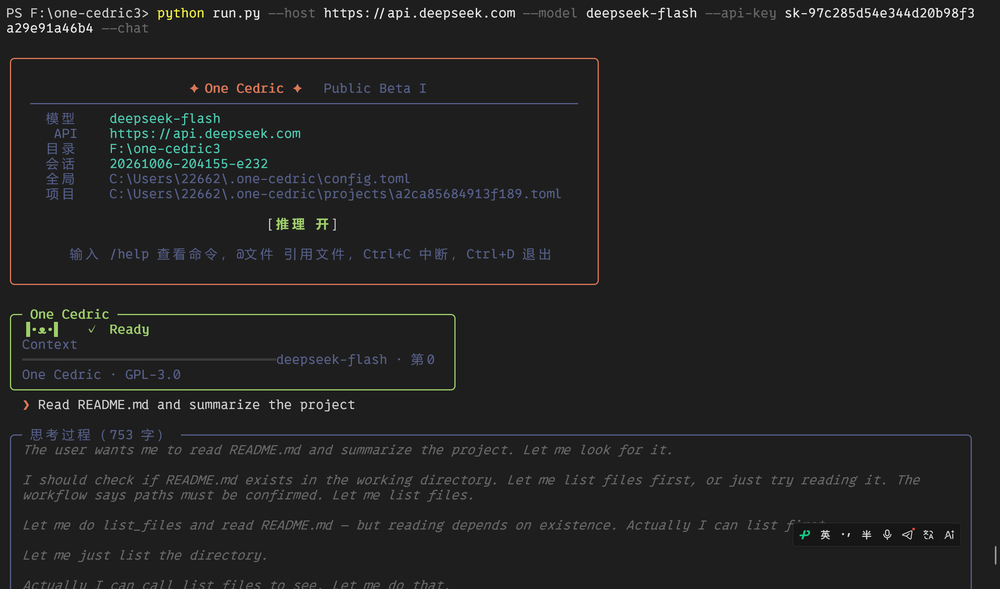
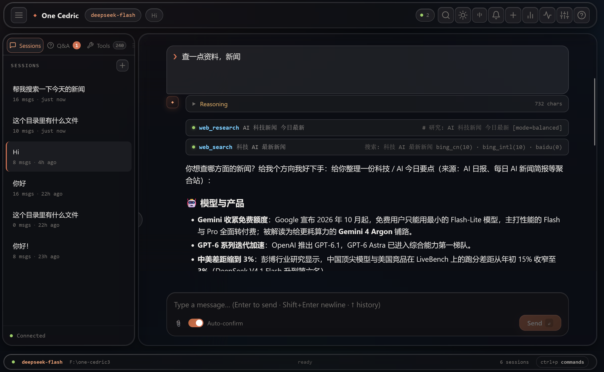
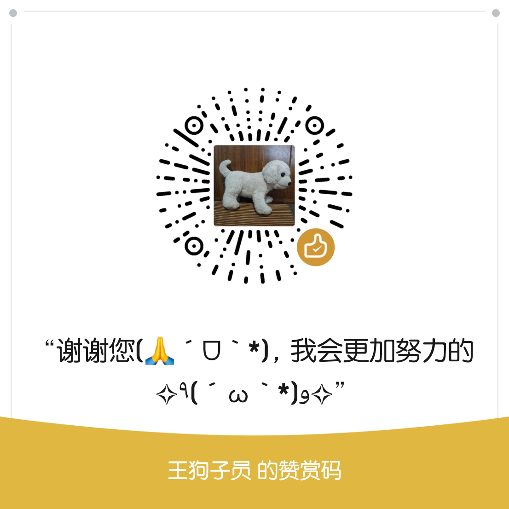

# One Cedric

> **An AI agent for beginners**
>
>  — built by a high school student
>
> @[Aoan2011](https://github.com/Aoan2011)
>
> .
> License: **GPL-3.0**
>
>  · Version: **Public Beta I**

> ***Note***: This repo is partly generated by AI.

[](https://python.org)
[](https://github.com/Textualize/rich)
[](LICENSE)


One Cedric is a local, file-smart AI agent that gives you **two frontends** — a terminal **CLI** and a Liquid Glass **WebUI** — over the same agent core. It connects to any **OpenAI-compatible** model provider (Ollama, DeepSeek, Kimi, ChatGPT, and more) and ships with **240+ built-in tools**: file operations, code search, a sandboxed terminal, web fetching, Office documents, databases, LSP analysis, and more. It is designed to be easy enough for a beginner to run in five minutes, while still being powerful enough to automate real work in your folders.
> **One Editor Lite** is part of **One Editor** family, MIT license. 



***

## 1. Installation

### Requirements


* **Python 3.10 or newer** (check with `python --version`)

* Git (recommended; enables snapshots & rollback)

* An LLM backend — one of:


  * **Ollama** (free, local): install from [https://ollama.com](https://ollama.com), then

    `ollama pull deepseek-flash`

  * **DeepSeek / Kimi / OpenAI / any OpenAI-compatible API**: just set `host` and

    `api_key`

### Install


```
# 1. Clone the repository
git clone https://github.com/Aoan2011/One-Cedric.git
cd One-Cedric

# 2. Install dependencies
pip install -r requirements.txt          # core + gateway + commonly used tools
pip install -r requirements-optional.txt # databases, archives, Chinese NLP… (optional)
```

> Missing optional packages are not fatal — the
>
> **Diagnose**
>
> screen lists exactly what is missing and how to install it (see [Troubleshooting](#6-troubleshooting--diagnose)).
>
> Dependency files: `requirements.txt` (runtime), `requirements-optional.txt`
> (packages that need system libraries), `requirements-dev.txt` (pytest, ruff,
> mypy, black — never needed at runtime). Or install everything at once with
> `pip install -e ".[all]"`.

### Verify it runs


```
python -m one_cedric --version    # project info + version
```


***

## 2. Quick Start

### Terminal (CLI)


```
# Launch the menu-driven CLI
python -m one_cedric

# Skip the menu and jump straight into chat
python -m one_cedric --chat
```

Type your first request, for example:


```
Read README.md and summarize the project.
```

The agent reads the file, summarizes it, and answers. Type `/help` at any time for

the command list, and `/exit` to quit.

### Web UI (Gateway)


```
python -m one_cedric --gateway
# then open http://127.0.0.1:2043 in your browser
```

You get a Liquid Glass chat interface: session sidebar, message tree, ask threads, tool output with syntax highlighting, an in-composer think-level selector, embedded Settings/Stats/Cron/Dream panels, a sandbox-terminal switch, a Diagnose panel, and a Custom Tools manager.

> The gateway binds to `127.0.0.1` by default. To reach it from another device
> on your LAN, use `--bind 0.0.0.0` **and** a token:
>
> ```
> python -m one_cedric --gateway --bind 0.0.0.0 --token <secret>
> ```
>
> Note that `--host` is the **model** endpoint (Ollama/DeepSeek), not the
> gateway bind address. The gateway address is `--bind`.
>
> Tool calls that write files or run commands are confirmed by you. The
> WebUI's auto-confirm switch is **off** by default — turn it on only when
> you trust the material the model is reading.

### 2.1 Uploading files vs. `@` references

One Cedric has **two different ways** to give the agent file content:

| | Upload (send now) | `@path` reference (attach on send) |
| --- | --- | --- |
| What it does | Immediately sends the file content to the agent as a message — analysis starts right away | Expands `@path` into file content **when you send your question**; content travels with that message |
| CLI | `/upload src/main.py README.md` (multiple paths) | Type `@src/main.py` anywhere in your message |
| WebUI | Click the **📎** button, drag & drop onto the window, or `Ctrl+V` paste — files are uploaded and a `@path` reference is auto-inserted into the input box | Type `@path` in the composer |
| When to use | You want the agent to **look at the material first**, then discuss it | The file is **part of a larger question** you are about to ask |
| Side effects | Processing starts immediately | Nothing happens until you send the message |

The `@` syntax is the same in both frontends:

```
@README.md              attach the whole file
@src/main.py#L10-L20    attach lines 10–20 only
@src/                   attach a directory listing
@src/**                 attach a recursive directory listing
```

> Tip: in the WebUI, uploading through 📎 / drag & drop / `Ctrl+V` does **not**
> send the message — it uploads the file and inserts an `@path` reference, so you
> can still type your question first. In the CLI, `/upload` **does** trigger the
> agent immediately; use `@path` inside a normal question instead.


***

## 3. Configuration

Configuration lives in TOML files:


| File                                 | Purpose                                                      |
| ------------------------------------ | ------------------------------------------------------------ |
| `~/.one-cedric/config.toml`          | Global defaults                                              |
| `~/.one-cedric/projects/<hash>.toml` | Per-project overrides (auto-generated per working directory) |
| `~/.one-cedric/integrations.json`    | MCP servers, hooks, custom tools                             |

Minimal `config.toml`:


```
[default]
model = "deepseek-flash"         # model name
host = "http://localhost:11434"  # Ollama by default; or https://api.deepseek.com
api_key = ""                     # leave empty for Ollama
think_level = "medium"           # minimal | low | medium | high | xhigh | max | ultra
reasoning_model = "auto"         # auto | on | off — pass reasoning_effort?
mode = "workspace"               # workspace | fullaccess | ask
sandbox_terminal = true          # sandbox the shell tool (recommended)
allow_arbitrary_shell = false    # require whitelist for bash
```

Key settings:


* **mode** — `workspace` (writes need your confirmation), `fullaccess` (no

  confirmation), `ask` (let the agent ask you questions when unsure).

* **sandbox\_terminal** — when on, unknown shell commands are blocked and sensitive

  environment variables are scrubbed before any command runs.

* **think\_level** — how much reasoning effort the model spends.

* **reasoning\_model** — tell the CLI whether the model is a reasoning model:
  `auto` (default, guess from the model name), `on` (always), `off` (never).
  With `on`, the request really carries `reasoning_effort` (Claude gets a
  `thinking` budget instead); `off` suppresses every reasoning parameter.
  Set it globally under `[default]`, per-model in `/model` → params, or with
  `ONE_CEDRIC_REASONING_MODEL=on|off|auto`.

* **ui.nerd\_font** — Nerd Font icons across the CLI and TUI (on by default).
  Set `nerd_font = false` under `[ui]`, or `ONE_CEDRIC_NERD_FONT=0`, to fall
  back to plain Unicode / ASCII glyphs.

* **ui.mouse** — click-to-position in the REPL input box (off by default).
  Mouse reporting steals the wheel from the terminal, so leave it off for
  normal scrolling; enable with `mouse = true` under `[ui]` or
  `ONE_CEDRIC_MOUSE=1` if you want click positioning.

You can also change most settings from inside the app: `/model`, `/think`, `/mode`

in the CLI; the **Settings** page in the WebUI.


***

## 4. Command Line

### Global options


```
python -m one_cedric [options]

--chat                 jump straight into the chat REPL
--gateway, --gw        start the WebUI gateway and keep running (Ctrl+C stops)
--bind <addr>          gateway bind address (default from config, 127.0.0.1)
--port <port>          gateway port (default from config, 2043)
--token <secret>       require a Bearer token on the gateway
--host <addr>          model/API endpoint, NOT the gateway address
--license              print the GPL-3.0 license text and exit
--version              print version and project info
--sandbox-terminal     force the shell sandbox on
--no-sandbox-terminal  force the shell sandbox off
-y, --yes              auto-confirm write/shell actions (unattended runs)
-p, --prompt <text>    run one prompt and exit (needs -y to be unattended)
```

> `--prompt` no longer auto-confirms tool calls. If you script One Cedric,
> pass `-y` explicitly — otherwise a model-generated command would run with
> no confirmation at all.

### The chat input box

The terminal REPL keeps the input box **pinned to the bottom** while output
scrolls above it, and it supports:

* **Mouse** — click anywhere in the line to move the cursor there.
* **Editing** — arrows, Home/End, Delete, Ctrl+W-style word movement.
* **Echo** — what you submit is printed back above the box (like any shell),
  so the conversation always shows your side of it.
* **Status bar** — the last row of the box is permanent and colour-coded:
  context usage (`ctx used/limit %`, teal, turning yellow at 70% and red at
  90%), turn/step counters (`轮3 步12`), the session cost (`$0.0123`, plus a
  `谷 ×0.25` / `峰` tag when peak pricing applies to the model), the git
  branch / ahead-behind / dirty count when you are inside a repository
  (dirty count in yellow), and the repo's toolchain (`py3.13 venv`,
  `node22 pnpm`, …; active venv in green). The bar drops sections from the
  right on narrow terminals instead of wrapping.
* **Powerline look** — with Nerd Fonts on (the default) the status bar renders
  as coloured powerline segments joined by ``  `` arrows, like an
  oh-my-posh / vim-airline bar; disable `[ui].nerd_font` to fall back to
  plain ` · `-separated text.
* **Peak / off-peak pricing** — `~/.one-cedric/pricing.toml` accepts a
  `[peak]` section describing "off-peak" (谷价) time windows such as
  DeepSeek's official discount (谷价 UTC 16:30–00:30, `deepseek-chat` ×0.5,
  `deepseek-reasoner` ×0.25). Costs computed for the status bar, `/cost`
  history and budgets automatically use the discount in effect at each turn.
  Manage it with `/peak` (`/peak preset deepseek`, `/peak windows 16:30-00:30`,
  `/peak tz +8`, `/peak discount my-model 0.5`, `/peak off`).

  ```toml
  # ~/.one-cedric/pricing.toml
  [peak]
  enabled = true                 # master switch
  windows = "16:30-00:30"        # off-peak windows (multiple: "10:00-12:00, 22:00-23:00")
  tz      = "UTC"                # UTC | local | +8 | -5:30
  default_discount = 1.0         # fallback multiplier for unlisted models

  [peak.discounts]               # model substring → off-peak multiplier
  deepseek-chat     = 0.5        # 5 折
  deepseek-reasoner = 0.25       # 2.5 折
  ```
* **Talking mid-turn** — while the agent is still working you can type and
  press Enter; you are then asked how to deliver it:
  * **queue** (Enter) — the message runs immediately after the current turn;
  * **interject** (`i`) — the in-flight answer is cut short and the model
    handles your message right away;
  * **cancel** (Esc) — drop it.
  Already-queued messages are shown in the box, and the prompt returns to
  normal editing once the turn ends.

> Mouse and the pinned box need a real terminal (TTY). When stdin is a pipe —
> CI, `echo … | one-cedric`, an editor task — the CLI transparently falls back
> to the classic line prompt.

### CLI slash commands


| Command                                                    | What it does                                                    |
| ---------------------------------------------------------- | --------------------------------------------------------------- |
| `/help`                                                    | Show help                                                       |
| `/new` `/clear` `/sessions` `/resume` `/save-as` `/export` | Sessions                                                        |
| `/model` `/think` `/reasoning` `/mode`                     | Model & thinking settings                                       |
| `/shell on\|off`                                           | Allow arbitrary shell commands                                  |
| `/sandbox on\|off`                                         | Toggle the sandbox terminal                                     |
| `/tools [list\|install\|uninstall\|gen]`                   | Tool manager & custom tools                                     |
| `/plan` `/todos`                                           | Plan mode & task list                                           |
| `/undo` `/rollback` `/snapshots`                           | Revert file changes                                             |
| `/diff [n]`                                                | Show a colorized diff (green/red/yellow with highlighted lines) |
| `/history` `/tag` `/untag`                                 | File history & tags                                             |
| `/stats` `/audit` `/cost`                                  | Statistics & costs                                              |
| `/pricing` `/peak`                                         | Model prices & peak/off-peak (谷价) windows                     |
| `/mem` `/cron` `/asks`                                     | Memory, cron jobs, ask threads                                  |
| `/config` `/save-config` `/profile` `/lang`                | Configuration & language                                        |

### WebUI slash commands

In the WebUI composer, type: `/new`, `/clear`, `/search`, `/export`, `/theme`,

`/lang`, `/settings`, `/sidebar`, `/help`, `/stats`, `/model`, `/think`,

`/sessions`, `/tools`, `/asks`, `/sandbox`, `/diagnose`.


***

## 5. Tools

### Built-in tools (240+)

One Cedric ships with a large tool set, grouped by category:


| Category     | Examples                                                                  |
| ------------ | ------------------------------------------------------------------------- |
| Files        | `read_file`, `write_file`, `edit_file`, `glob`, `grep_regex`, `file_info` |
| Web          | `web_fetch`, `web_search`, `web_research`, `http_request`                 |
| Browser      | `browser_open`, `browser_click`, `browser_type`, `browser_extract`, `browser_screenshot`, `browser_nav` — a simulated browser (Playwright + your system Edge) that can open pages, click, type, scrape text and take screenshots |
| Version      | `github_latest_version` — fetches the latest release tag from any GitHub repo (default `Aoan2011/One-Cedric`) |
| Terminal     | `bash`, `bash_bg` (sandboxed by default)                                  |
| Data         | `sqlite`, `csv_query`, `json_query`, `postgres_query`                     |
| Office       | Word / PPT / Excel / PDF read & convert                                   |
| Code help    | LSP hover / definition / references / symbols / diagnostics               |
| Media & more | image, audio, video, QR code, archive, email, weather …                   |

Browse and toggle them from the CLI (`/tools`) or the WebUI **Tools** sidebar tab.

### Custom tools (install / uninstall / AI-generate)

You are not limited to the built-ins:


* **Install a command-line tool** — any executable that reads a JSON object from

  stdin and writes its result to stdout can become a tool:


```
/tools install <name> <command...>
# example: /tools install weekday python C:/tools/weekday.py
```


* **Uninstall** — `/tools uninstall <name>`

* **List** — `/tools list`

* **AI-generate a tool** — describe what you want and One Cedric writes the Python

  script + JSON schema for you:


```
/tools gen a read-only tool that returns the CPU temperature
```

Generated tools are stored in `~/.one-cedric/custom_tools/<name>.py` and registered

as `custom__<name>`. The same actions are available in the WebUI under

**Tools → Custom**.


* **MCP servers** — connect to any Model Context Protocol stdio server; its remote tools appear automatically as `mcp__<server>__<tool>`.


### Third-party skills from `~/.agents/skills` (read-only)

One Cedric can also read documentation-style skills that other agent runtimes

install into `~/.agents/skills/<name>/SKILL.md`. This is strictly **read-only**:

your data directory stays in `~/.one-cedric/` and nothing in `~/.agents` is ever

modified. When skills are detected, a single `agents_skill` tool is exposed to the

model — call it without a name to enumerate the available skills, then pass a

`name` to read the full `SKILL.md` instructions and act on them (for example by

invoking the CLI the skill relies on). You can disable it by setting

`agents_skills.enabled = false` in `~/.one-cedric/integrations.json`, and the

CLI/WebUI Diagnose panels both show how many skills were loaded.

***

## 6. Troubleshooting & Diagnose


* **CLI**: main menu → **Diagnose**.

* **WebUI**: press the ⚡ button in the top bar, or type `/diagnose`.

The Diagnose panel checks:


* core & optional Python packages (`fastapi`, `rich`, `requests`, …)

* Python & Git availability

* LSP configuration readiness

* registered tool count, access mode, sandbox-terminal state

If something is missing it tells you the exact `pip install` command.


***

## 7. WebUI

Start it with `python -m one_cedric --gateway`.


* **Liquid Glass design** — frosted panels, glass buttons, acrylic strength

  (off/low/medium/high), light & dark themes.

* **Session sidebar** — sessions, asks, tools, outline, and favorites tabs.

* **Message tree** — branch, edit, regenerate, pin, search, and export messages.

* **Tool output** — collapsible tool results with syntax highlighting.

* **In-composer think level** — click the ⚡ badge in the input bar to open a
  floating effort window: a wide track with a damped draggable dot across
  Minimal → Low → Medium → High → X-High → Max → Ultra (7 levels, passed
  through to the model as real reasoning-effort values). Dragging to **Ultra**
  turns the whole track into a blue-purple gradient with glowing particles.

* **Embedded panels** — Settings, Stats, Cron jobs, and Dream all open as

  in-page glass panels (no separate tabs):

  * **Settings** — model, host, API key, temperature, think level, theme,

    acrylic, hue, language, sandbox terminal, notifications, custom commands,

    network/LAN status, and session data (export / import / clear).

  * **Stats** — sessions, messages, pins, asks, tool usage, chars generated, per-session bars, role donut, and the tool table.

  * **Cron jobs** — list, add, enable/disable, run-once and delete scheduled agent tasks. Shares the same storage as the CLI `/cron` command.

  * **Dream** — run a dream review (days + optional focus), view the latest dream stats and the dream history. Mirrors the CLI `/dream` command.

* **Diagnose** — dependency & environment health at a glance.

* **Custom tools** — install, remove, and AI-generate tools without touching a file.

* **Ask threads** — answer model questions inline in the chat.

* **LAN access** — the **Settings** panel shows whether the gateway is reachable from your local network and lists the LAN addresses. By default the gateway binds to `127.0.0.1` (localhost only); start it with `python -m one_cedric --gateway --host 0.0.0.0` to let other devices on your LAN open it (optionally add `--token <secret>`).

Keyboard shortcuts: `Ctrl+K` new session · `Ctrl+B` toggle sidebar · `Ctrl+,`

settings (embedded panel) · `Ctrl+F` search · `Ctrl+P` command palette · `?` help.


***

## 8. Design Notes — three "whys"

### Why the shell has three layers

A model-generated shell command is untrusted by definition, so One Cedric
never runs one blindly. Every `bash` call is classified first
(`tools/shell.py::classify_command`):

| Level | Meaning                          | Behaviour                          |
| ----- | -------------------------------- | ---------------------------------- |
| 0     | `blocked`                        | Dangerous patterns, blacklisted binaries, shell metacharacters outside quotes → **permanently refused** |
| 1     | `whitelist`                      | Known-safe prefixes (`git status`, `ls`, …) → **run directly** |
| 2     | `known`                          | Generally safe commands → **single confirmation** |
| 3     | `unknown`                        | Arbitrary commands → **strong warning + forced confirmation** |

On top of that sits the **sandbox terminal** (`sandbox_terminal`, on by
default): it hard-blocks every `unknown` command even in `fullaccess` mode,
and it launders the environment — stripping variables whose names contain
sensitive keywords and marking the process with `ONECEDRIC_SANDBOX=1` — so a
rogue command cannot silently read secrets or inherit your whole shell state.

Three layers buy three different things: frictionless flow for the commands
you run constantly, low friction for the ones you confirm once, and zero
tolerance for anything dangerous — with the sandbox as a second wall even
when you opt into full access.

### Why snapshots use git

Before every write, One Cedric records a snapsho (`git_snap.py`): it captures `HEAD`, runs `git stash push --include-untracked` and immediately pops it back, keeping the stash as an undo point. Rolling back a bad edit restores that stash.
Git is the right tool here because it is a battle-tested, content-addressed version store: objects are stored once and reused, so snapshots stay cheap; it works the same on every platform; it captures both tracked and untracked files; and rollback to an arbitrary point is a single well-defined operation. Reimplementing "backup the files before I touch them" as a home-grown directory copier would be slower, less robust, and harder to verify. If the working directory is not a git repository, snapshots are simply disabled and Diagnose reports it.

### Why tool schema is separated from implementation

`tools/schema.py` is pure data — the OpenAI function-calling JSON schemas (name, description, parameters) the model sees. The actual work lives in `tools/_handlers_*.py`, dispatched by `tools/_dispatch.py`, with write vs read-only classification declared centrally in `WRITE_TOOLS` / `READONLY_TOOL_NAMES`.

Separation pays off in four ways:

* **The contract is stable.** The model only ever sees the schema, so implementation can be refactored, cached, or lazy-loaded without changing the wire protocol.
* **One schema, many consumers.** The same list feeds the model request, the WebUI **Tools** tab, plan-mode readonly filtering, and the custom-tool merger — consistency is free.
* **Policy is auditable in one place.** Permission (write/read-only) mutating-ness and cacheability are declared by name centrally instead of being scattered through handlers.
* **Failures stay local.** A broken handler degrades only that tool; the schema export and the tool list keep working.

***

## 9. Project Layout


```
one_cedric/
├── _version.py           # single source of truth for the version
├── cli.py                # CLI entry (--gateway / --bind / --port / --token …)
├── core.py               # agent loop, permission layer, sandbox terminal, REPL
├── config.py             # project metadata, defaults, shell policy tables
├── storage.py            # sessions, global/project config, profiles
├── integrations.py       # MCP servers, hooks, custom tools (install/uninstall)
├── lsp/                  # LSP client & language tooling
├── gateway/
│   ├── server.py         # FastAPI app, auth, security headers
│   └── webui/            # index.html + app.js
│                         # styles are layered: tokens.css → style.css → polish.css
├── tools/                # 250 tool schemas + handlers
│   ├── schema.py         # the model-facing contract (pure data)
│   ├── _dispatch.py      # schema name → handler routing
│   └── _handlers_*.py    # implementations, grouped by area
└── ui/                   # TUI screens + live_input.py (bottom-pinned prompt)

tests/                    # pytest suite (registry, security, gateway, e2e)
requirements*.txt         # runtime / optional / dev dependency sets
SECURITY_AUDIT.md         # audit findings and their status
```

## 10. Contributing

One Cedric is a student project — contributions, ideas, and bug reports are very

welcome. Open an issue or a pull request on

[https://github.com/Aoan2011/One-Cedric](https://github.com/Aoan2011/One-Cedric).

## 11. License

One Cedric is free software released under the **GNU General Public License v3.0**.

See the `LICENSE` file, or run:


```
python -m one_cedric --license
```

Copyright (C) 2026 **Aoan2011** · [https://github.com/Aoan2011/One-Cedric](https://github.com/Aoan2011/One-Cedric)

## 12. Development

```bash
pip install -r requirements-dev.txt

python -m pytest -q              # 247 tests
python -m ruff check .           # lint (bug-level rules are enforced in CI)
python -m compileall -q one_cedric
```

The test suite covers the tool registry (all 250 schemas ↔ handlers ↔
dispatch), the three-layer shell policy and sandbox env scrubbing, config
storage layering, token enforcement on every gateway route, real end-to-end
calls to local tools, the CLI surface, the REPL input editor, and the WebUI
asset/CSP invariants.

CI (`.github/workflows/ci.yml`) runs compileall + ruff + pytest on Python
3.10–3.13 plus one Windows job, and builds the wheel to assert that the
packaged version comes from `one_cedric/_version.py`.

Security notes and the full audit report live in
[SECURITY_AUDIT.md](SECURITY_AUDIT.md).

## 13. Buy me a coffee


## 14. Star History

<a href="https://www.star-history.com/?repos=aoan2011%2Fone-cedric&type=date&legend=top-left">
 <picture>
   <source media="(prefers-color-scheme: dark)" srcset="https://api.star-history.com/chart?repos=aoan2011/one-cedric&type=date&theme=dark&legend=top-left" />
   <source media="(prefers-color-scheme: light)" srcset="https://api.star-history.com/chart?repos=aoan2011/one-cedric&type=date&legend=top-left" />
   
 </picture>
</a>